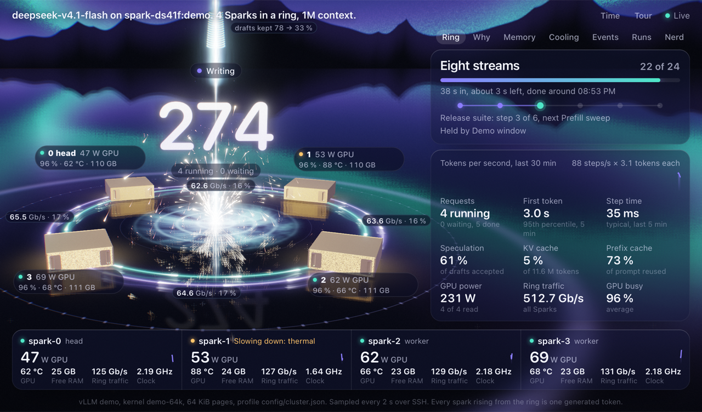
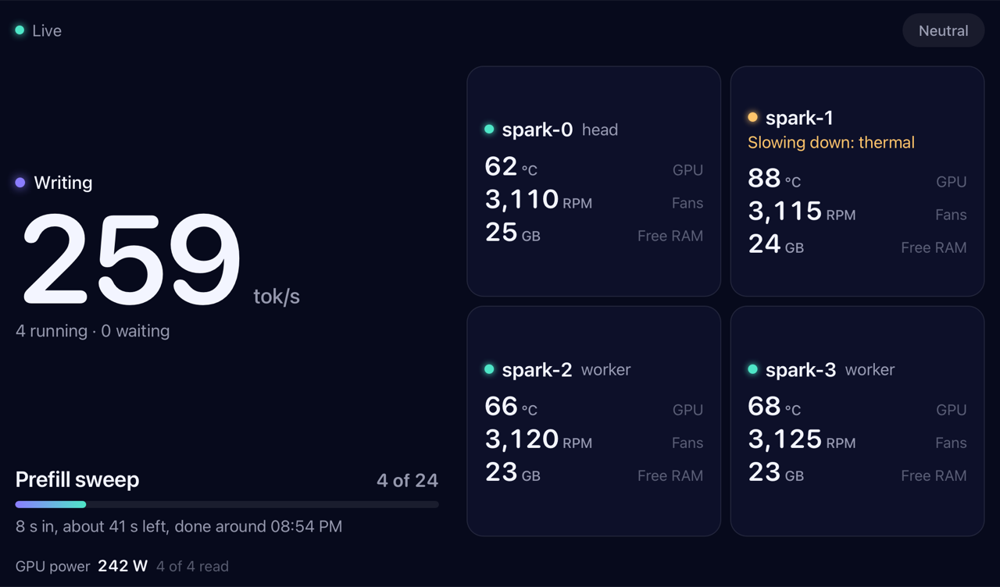

# ringtop

A browser view of what a vLLM cluster of DGX Sparks is doing right now. It reads the nodes over SSH, installs nothing on them, and needs nothing beyond the Python standard library.





## What it shows

- The ring and its cables.
- Every Spark: GPU, clock, temperature, fans, memory, disk, network.
- The engine: requests, tokens per second, cache.
- Runs, and history.

Without `--store`, the page keeps the last 30 minutes in memory. Longer history and the one-time read of old engine logs need `--store FILE`, a history database on the machine that serves the page. When ringtop starts with a store that is still empty, it reads old engine logs once (also `~/ds41f-logs/*.log.gz` if present) to fill the look-back.

A Spark can be opened: a 3D model with its parts and their readings. There is also a calm page at `/wall`, meant for a phone or a TV, and a Prometheus endpoint at `/metrics`.

## Quick start

Try it without hardware:

```
python3 ringtop.py --demo
```

Then open http://127.0.0.1:8377. The demo plays a ring of four Sparks with made-up data. `--demo-form` plays other made-up setups (one, ring2, ring3, ring6, switch4, find4), and `--demo-faults` plays the troubles one after another. `--demo-form NAME` works only together with `--demo`:

```
python3 ringtop.py --demo --demo-form ring6
```

On a real ring, run it on the head node:

```
python3 ringtop.py
```

or from any machine that reaches the head node over SSH:

```
python3 ringtop.py user@head-node
```

The page is on port 8377 unless you pass `--port`.

## Requirements

- On the machine that serves the page: Python 3.9 or newer (tested with 3.9 and 3.13), and a browser with WebGL2.
- On the nodes: `python3`, ssh with a key, `nvidia-smi`, and docker for the engine readings.

## How it reads

Over SSH in BatchMode, so it needs key login. A small Python program is sent as text to `python3 -` on each node. It reads `/proc`, `/sys`, `nvidia-smi`, `docker inspect`, and the engine's `/metrics` on 127.0.0.1 of that node. Nothing is installed on the nodes.

The node map comes from `config/nodes.json` of a spark-ds41f checkout. By default that is the newest `~/projects/spark-ds41f*`; use `--repo PATH` to point at another. Without spark-ds41f, give a file with `--nodes FILE`. It uses the same JSON format as `config/nodes.json` of spark-ds41f; the head is marked with `"head": true`, and if no node is marked, ringtop looks for the head as described under Head node.

What it never does: it writes nothing to the Sparks, changes nothing in the engine, and never sets fans. The page changes nothing either.

What leaves a node:

- Of other processes, only the program name.
- The names of recognized benchmark and lab programs.
- Arguments of the engine container and log lines, with keys masked (`***`).
- Lines from the kernel journal (GPU errors such as Xid, out-of-memory, hung tasks) and lines of spark-ds41f's memory guard, each cut to at most 160 characters.
- The content of `~/spark-hold.json` and the file names of spark-ds41f's lab queue.
- Versions and settings: board, BIOS and kernel version; driver and VBIOS versions; NIC and SSD firmware versions; some kernel settings.
- Facts from the engine's start log.
- The ports (not the addresses) of connections to the engine.
- Environment variables: harmless settings (`NCCL_`, `VLLM_`, `CUDA_` and similar) in clear text, everything else only as a checksum.

Nothing leaves your own machines unless you turn on ntfy (below).

## Head node

If the node map does not name a head, ringtop finds it from the GPU programs every Spark already reports. vLLM names the parts of an engine spread over several Sparks `_TP0`, `_TP1` and so on; the head is the Spark with `_TP0`. ringtop looks every 15 s and sets or changes the head only when the same candidate showed in two looks in a row, so about 30 s after start. It never guesses between several candidates.

This works only for vLLM engines named that way. Otherwise, name the head in the node file.

## The calm page and /metrics

The page has no login and listens on 127.0.0.1 by default. To show the calm page elsewhere, `--wall ADDRESS` serves only that page on one more address, and `--wall-from ADDRESS` limits who may read it.

`/metrics` is a Prometheus endpoint. It is served on the main address (the same address and port as the main page), never on the `--wall` address, which serves only the calm page.

## Phone notifications (optional)

Off by default. Without the options below, nothing is sent.

- `--ntfy-topic-cmd COMMAND`: a command that prints your secret ntfy topic.
- `--ntfy-server`: the ntfy server (default ntfy.sh).
- `--ntfy-dry`: sends nothing and prints the keys of the messages it would send (not their texts).
- `--ntfy-state FILE`: remembers what was sent across restarts.

Fixed messages exist for: a Spark gone, a clock stuck low under load, a fan standing, a cable down, the engine silent. Each has an all-clear. At most 12 messages go out in 24 hours within one run. Across restarts this holds only with `--ntfy-state FILE`, which keeps when messages were sent.

## Tested on

One ring of four DGX Sparks running spark-ds41f, and nothing else. Any other setup (another number of Sparks, a switch instead of a ring, another GB10 device) is marked by the page itself as "untested setup". The demo forms draw such setups from made-up data; that does not make them tested.

ringtop is made for rings running [spark-ds41f](https://github.com/christopherowen/spark-ds41f). It is a separate project, and nothing here speaks for spark-ds41f or its author.

## 3D model

`assets/spark.glb`, built in Blender by `model/build_spark.py`. Own shapes and patterns; no logo, no photo. Without the file the page shows a plain box.

## Tests

```
python3 test_ringtop.py
```

The tests of the page rules need `node`; without it they are skipped.

## License

Apache 2.0.
